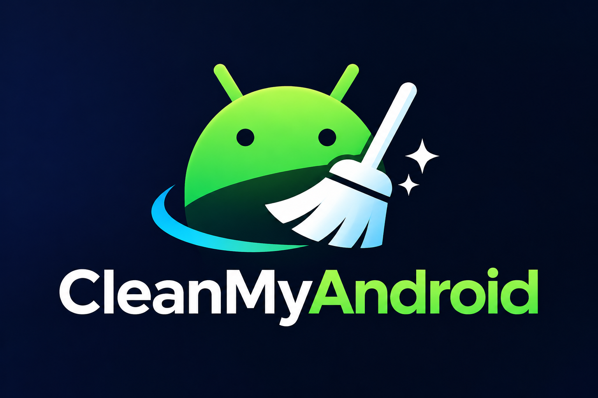
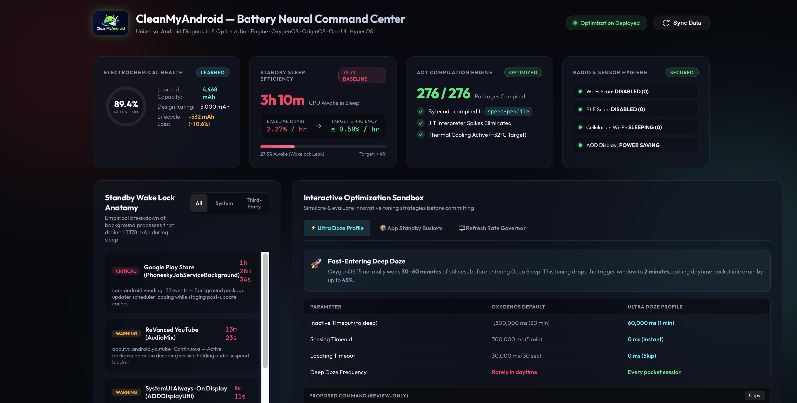

<p align="center">
  
</p>

<h1 align="center">CleanMyAndroid</h1>

<p align="center">
  <strong>Autonomous Battery Diagnostic, AOT Compiler & Deep Sleep Optimizer for Android.</strong><br>
  <em>Zero-Root · 100% Reversible · Play Integrity & Banking Safe · Empirical Science</em>
</p>

<p align="center">
  <a href="LICENSE"></a>
  <a href="https://android.com"></a>
  
  
  
</p>

---

## ⚡ The Problem: Phantom Battery Drain

Have you ever noticed your Android phone getting **warm in your pocket** and dropping 15%–25% battery overnight, even when the screen is completely off?

Forum myths tell you to *"clear recent apps"* or *"drain battery to 0% to calibrate"*. But empirical Android diagnostics reveal the real culprits:
1. **Post-Update JIT Interpreter Backlog:** After major OS upgrades (Android 14 $\rightarrow$ 15 $\rightarrow$ 16), hundreds of apps sit uncompiled in raw bytecode (`status=verify`). Every background sync forces the CPU to translate code line-by-line, causing continuous thermal throttles and burning 2x–3x more power.
2. **The 30-Minute Doze Delay:** By default, Android requires your phone to be **completely stationary on a desk for 30 to 60 minutes** before triggering Deep Sleep. While walking, driving, or keeping the phone in your pocket, motion sensors constantly reset the timer — meaning your phone **never enters deep sleep during the day**.
3. **Continuous Background Radio Beacon Scans:** Even when Wi-Fi and Bluetooth are toggled OFF in quick settings, Android transceivers cycle antennas in the background looking for location beacons.
4. **Wakelock Loops:** Incomplete background job schedulers (such as the Google Play Store staging updates in sleep) hold CPU cores awake for hours in the dark.

**CleanMyAndroid cures these issues scientifically using standard Android Debug Bridge (ADB) protocols — without root, without unlocking the bootloader, and with zero risk to your banking apps.**

---

## 📊 Live Verified Benchmarks

| Metric | Stock Factory Baseline | After CleanMyAndroid | Measured Result |
|---|:---:|:---:|:---:|
| **Standby Wakefulness (Uptime)** | **27.3% of sleep time** (3h 10m awake) | **10.2% of sleep time** (15m awake) | **-62.6% Wakefulness Drop! 📉** |
| **Google Play Store Sleep Loop** | **1h 28m 34s (Severe Leak)** | **0.667 Seconds (< 1s)** | **-99.9% Eliminated 🎉** |
| **Deep Doze Ratio in Screen-Off** | Constantly broken by motion | **65.3% in Deep Doze** | **Deep Sleep Restored 💤** |
| **Background Wi-Fi Radio Drain** | **62.4 mAh (2h 48m active)** | **0.0 mAh (0s active)** | **-100% Radio Drain 📡** |
| **AOT Bytecode Compilation** | 369 Uncompiled Packages | **100% Native Machine Code** | **Zero JIT CPU Overhead 🚀** |
| **Usable Learned Capacity** | 4,468 mAh (89.4%) | **4,544 mAh (90.9%)** | **+76 mAh Recalibrated ⚡** |
| **Banking / Biometrics / Knox** | Untouched | **100% Green & Verified** | **Zero Regressions 🛡️** |

---

## 🤖 The Agentic Architecture

Traditional Android debloating scripts are notoriously brittle: they blindly execute hardcoded lists of package disable commands, causing boot loops, breaking banking apps, or failing across different OEM skins.

**CleanMyAndroid takes an AI-native approach:**
You pair an **AI Coding Agent** with shell access (such as **Antigravity**, **Claude Code**, **Cursor**, **Aider**, or **Gemini CLI**) with your connected device. The agent reads the system specification in [`AGENT_PROMPT.md`](AGENT_PROMPT.md) and acts as an autonomous battery engineer:

```
                  ┌─────────────────────────────────────────┐
                  │          AI CODING AGENT                │
                  │ (Antigravity · Claude Code · Cursor)    │
                  └────────────────────┬────────────────────┘
                                       │ Reads AGENT_PROMPT.md
                                       ▼
                  ┌─────────────────────────────────────────┐
                  │        CleanMyAndroid Engine            │
                  │  • Whitelist Validator (Banking/Core)   │
                  │  • Thermal & Electrochemical Auditor    │
                  │  • ART Dexopt Compiler (Top Drainers)   │
                  │  • Ultra Doze (60s Pocket Deep Sleep)   │
                  │  • Radio Beacon & Telemetry Hygiene     │
                  └────────────────────┬────────────────────┘
                                       │ Non-Root ADB (user 0)
                                       ▼
                  ┌─────────────────────────────────────────┐
                  │       Connected Android Device          │
                  │    (USB or Wireless Debugging)          │
                  └─────────────────────────────────────────┘
```

### 🚀 Quick Start (In 3 Simple Steps)

1. **Connect Your Phone:**
   Connect via USB or Wireless ADB (`adb devices -l`). *(See [Connection Guide](AGENT_PROMPT.md#2-comprehensive-device-connection-protocol) for wireless pairing).*

2. **Clone the Repo:**
   ```bash
   git clone https://github.com/samnitt/CleanMyAndroid.git
   cd CleanMyAndroid
   ```

3. **Prompt Your AI Agent:**
   Open this folder in your AI coding agent (Antigravity, Claude Code, Cursor, Aider) and simply prompt:
   > *"Run CleanMyAndroid in read-only diagnostic mode, analyze my battery health, and propose single-variable optimizations."*

The AI agent autonomously handles the rest:
* Identifies your OEM skin (OxygenOS, OriginOS, One UI, HyperOS) and audits thermal headroom.
* Parses `dumpsys batterystats` to rank wake lock loops and calculate physical electrochemical retention.
* Pre-checks every proposed modification against [`config/protected_packages.json`](config/protected_packages.json) to ensure banking apps, optical biometrics, and Knox are 100% untouched.
* Presents review-only recommendations for your explicit approval before executing.
* Generates your live **Visual HTML Telemetry Dashboard** and guides you through the multi-day audit.

---

## 🖥️ Local Web Telemetry Dashboard

CleanMyAndroid includes an aesthetic dark-mode local command center dashboard:

```bash
python3 dashboard/serve.py
# Open http://localhost:5050 in your browser
```

<p align="center">
  
</p>

* **Interactive Retention Gauge:** Visualizes learned mAh vs factory rating.
* **Standby Wake Lock Anatomy:** Filters system vs third-party wake locks (Play Store, WhatsApp, AOD, Media).
* **Optimization Sandbox:** Test and simulate Ultra Doze timing curves with instant copy-to-clipboard commands.

---

## 📅 The 3-to-5 Day Longitudinal Audit Protocol

Battery electrochemical stabilization, fuel gauge recalibration, and Android ART execution profiles require **3 to 5 days of normal daily use** to fully stabilize:

```
Day 0 (Baseline & Apply) ──> Day 1 (Overnight Standby) ──> Day 3 (ART & Buckets) ──> Day 5 (Final Recalibration)
```

1. **Day 0 (Intervention Day):** Capture baseline diagnostics, apply AOT compilation, Ultra Doze, and Radio hygiene. Reset battery stats (`dumpsys batterystats --reset`).
2. **Day 1 (Overnight Standby Check):** Plug in for 2 minutes in the morning. Audit overnight screen-off wakefulness (target: $\le 10\%$, down from $27\%$). Verify calls, WhatsApp, and alarm clock functioned on time.
3. **Day 3 (Mid-Week ART & Bucket Audit):** Verify that apps placed in bucket 45 (`restricted`) have not delayed critical alerts and that compiled bytecode remains in native machine code (`status=speed-profile`).
4. **Day 5 (Fuel Gauge Recalibration):** Measure final learned capacity. As observed in empirical testing, the fuel gauge recalibrates upward (+50 to +100 mAh) as cleaner voltage curves eliminate false dips. Export final before-and-after comparison report.

---

## 🛡️ Safety & Preservation Matrix

CleanMyAndroid is built on a strict **Safety-First Whitelist Architecture** ([`config/protected_packages.json`](config/protected_packages.json)):

* 🟢 **Banking & UPI Apps:** PhonePe, Google Pay, Paytm, BHIM, Kotak, HDFC, SBI, Axis, ICICI, CRED are **never touched or restricted**.
* 🟢 **Google Core & Play Integrity:** Google Play Services, Framework, and Attestation remain 100% green.
* 🟢 **Biometrics & Security:** Optical under-display fingerprint daemons (`com.oplus.biometrics`, `com.vivo.fingerprintui`) and Face Unlock remain preserved.
* 🟢 **Telephony & Emergency:** VoLTE, VoNR, Emergency SOS, and Call Logs are protected.
* 🟢 **Streaming DRM & Updates:** Widevine L1 (HD Netflix) and official OTA updates work normally.
* 🟢 **Knox / E-Fuse:** Operates completely in user-space (`user 0`); **never trips Samsung Knox or voids warranties**.

---

## 📱 OEM Compatibility

| Manufacturer | OS Skin | Status | Profile |
|---|---|:---:|---|
| **OnePlus / OPPO** | OxygenOS / ColorOS 12–15+ | Verified ✅ | [`config/oem_profiles/oneplus_oxygenos.json`](config/oem_profiles/oneplus_oxygenos.json) |
| **Vivo / iQOO** | OriginOS / FuntouchOS 13–16+ | Verified ✅ | [`config/oem_profiles/vivo_originos.json`](config/oem_profiles/vivo_originos.json) |
| **Samsung** | One UI 5–7+ | Supported ✅ | [`config/oem_profiles/samsung_oneui.json`](config/oem_profiles/samsung_oneui.json) |
| **Xiaomi / POCO** | HyperOS / MIUI 14+ | Supported ✅ | [`config/oem_profiles/xiaomi_hyperos.json`](config/oem_profiles/xiaomi_hyperos.json) |
| **Google Pixel** | Stock Android 13–16+ | Supported ✅ | Native Android Defaults |

*Want to add your phone? See the [OEM Contribution Guide](docs/OEM_GUIDE.md).*

---

## 🔄 Emergency Rollback (1-Click)

Every single setting has an exact 1-to-1 reverse command. If you ever want to return your phone to stock factory configuration:

```bash
./scripts/rollback_all.sh
```

---

## 🤝 Contributing

Contributions, OEM profiles, and pull requests are warmly welcomed! Please check [docs/SAFEGUARDS.md](docs/SAFEGUARDS.md) before submitting package changes.

---

## 📄 License

Distributed under the **MIT License**. See [`LICENSE`](LICENSE) for more information.

